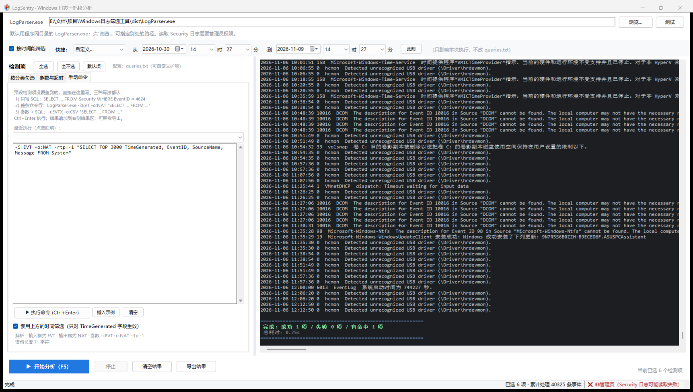

# LogSentry · Windows 日志一把梭分析

便携式 Windows 日志分析小工具：勾选多个检测项 → 一键顺序执行 → 在同一个窗口里比对
「攻击失败痕迹」和「攻击成功痕迹」。例如 4625 刷屏 + 紧随其后的 4624 成功登录 + 4720 新建账户 +
7045 安装服务，就是一条完整的爆破成功链。

底层调用微软 Log Parser 2.2（`LogParser.exe`）。**不需要 Python、Node 或任何第三方运行时**：
单文件 exe 拷到任意 Win10 / Win11 机器双击即可（系统自带 .NET Framework 4.8），自动 UAC 提权。

> Win7 SP1 / Win8 需要系统里已有 .NET Framework 4.5+。



## 功能

- **26 个内置检测项**，覆盖登录爆破、账户变更、服务安装（PsExec 痕迹）、计划任务、日志清除、
  Defender 状态、Sysmon 进程创建等常见痕迹；可任意多选，按顺序执行。
- **时间筛选**：顶部筛选条支持最近 1h / 24h / 3d / 7d / 30d 与自定义区间，可精确到分秒；
  走 SQL 的 `TimeGenerated` 条件，不改 `queries.txt`。
- **手动命令**：左栏「手动命令」页可直接手写 SQL 或整条 LogParser 命令行，Ctrl+Enter 执行，
  历史命令自动留存。
- **导出**：文本 txt / CSV（每项一个文件 + 概述）/ Excel xlsx（每项一个工作表），
  CSV 与 xlsx 走 `-o:CSV` 重新查询生成，不在 NAT 文本上切列，中文不会串位。
- **配置驱动**：界面完全由 `queries.txt` 生成，新增检测项只改配置，不用改代码、不用重编译。

## 快速开始

1. 下载 `dist/LogSentry_Portable.exe`，双击 → UAC 确认 → 界面打开。
   （首次运行会在临时目录解压出程序文件夹，其中已包含 `LogParser.exe`、配置与
   `dotNetFx40_Full_x86_x64.exe`：目标机没装 .NET Framework 4 时，双击包里的安装包装好即可。）
2. 左栏「按分类勾选」里挑检测项，例如同时勾上「登录失败」与「登录成功」。
3. 点 `▶ 开始分析（F5）`，结果区按项分隔显示，末尾给出成功 / 失败 / 命中汇总。
4. 需要留档就点「导出结果」，选 xlsx 或 csv。

只用 `dist/LogSentry.exe` 也可以：把它和 `LogParser.exe`、`queries.txt` 放在同一目录再双击。

## 交付物

| 文件 | 说明 |
| --- | --- |
| `dist/LogSentry_Portable.exe` | **单文件便携版**（自带解压引导器 + zip 载荷，含 `.NET Framework 4` 离线安装包；双击后解压到临时目录并自动启动） |
| `dist/LogSentry.exe` | 主程序本体，版本 1.0.0.0，需与 `LogParser.exe`、`queries.txt` 同目录 |
| `dist/LogParser.exe` | 微软 Log Parser 2.2，查询引擎 |
| `dist/LogParser.chm` | Log Parser 官方帮助文档 |
| `dist/queries.txt` | 检测项配置，改它就能增减检测项 |
| `dist/使用说明.txt` | 面向使用者的手册：界面、时间筛选、判读方法、导出、配置扩展示例、常见问题 |
| `dist/dotNetFx40_Full_x86_x64.exe` | .NET Framework 4 离线安装包（微软官方，未修改），给没装 .NET 4 的老机器用 |

## 仓库结构

```text
LogSentry/
├─ src/                     源码（C# 5 / .NET Framework 4.x，用系统自带 csc 直编）
│  ├─ app.manifest          requireAdministrator（双击即 UAC 提权）
│  ├─ Program.cs / EntryPoint.cs   启动入口、命令行分发（--selftest / --smoke）
│  ├─ MainForm.cs           全部界面与执行流程（左栏三页 + 结果区 + 导出）
│  ├─ Engine.cs             LogParser 封装：参数拼装、编码、超时、输出清理
│  ├─ Exporters.cs          CSV / XLSX 生成（手写 OOXML + ZipArchive）
│  ├─ Config.cs / BuiltinQueries.cs   queries.txt 解析 + 内置检测项
│  ├─ Launcher.cs           便携版引导器：自解压外壳 + 启动主程序（独立 exe，不进主程序编译）
│  ├─ launcher.manifest     引导器清单（asInvoker，不提权）
│  ├─ SelfTest.cs           --selftest 的 12 组断言
│  └─ UiSmokeTest.cs        --smoke 的界面/导出/手动命令自动化冒烟
├─ build.ps1                csc 编译 → dist/LogSentry.exe + _selftest.exe + _smoke.exe
├─ pack-portable.ps1        编译引导器 + 打 zip 载荷 + 三段拼接 → dist/LogSentry_Portable.exe
├─ dist/                    交付产物（见上表）
├─ docs/
│  ├─ screenshots/          界面截图
│  ├─ evidence/             自检 / 冒烟 / 导出的实测输出
│  └─ DEVELOPMENT.md        开发与验证记录（LogParser 实测坑、迭代记录、复检命令）
└─ queries.txt              （dist/ 内副本）检测项配置
```

## 技术选型

- **C# WinForms / .NET Framework 4.x**：系统自带，Win10/11 是 4.8，无需额外运行库。
- 编译只用系统自带的 `C:\Windows\Microsoft.NET\Framework64\v4.0.30319\csc.exe`（C# 5 语法），
  不需要 Visual Studio、Roslyn 或 Reference Assemblies。
- `src/app.manifest` 写死 `requireAdministrator`：读 Security 日志必须有管理员权限。
- 执行用 `Process` + `async/await` + `RedirectStandardOutput`，`CreateNoWindow = true` 不弹黑框，
  输出按 OEM 代码页（简体中文为 CP936）解码，中文不乱码。

## 构建

```powershell
# 编译 dist\LogSentry.exe + dist\_selftest.exe + dist\_smoke.exe
powershell -NoProfile -ExecutionPolicy Bypass -File .\build.ps1

# 再打单文件便携版（输出 dist\LogSentry_Portable.exe，含 .NET 4 离线安装包）
powershell -NoProfile -ExecutionPolicy Bypass -File .\pack-portable.ps1 -IncludeDotNet
```

`build.ps1` 自动寻找 `csc.exe`（优先 Framework64，回退 32 位），优先使用
`Reference Assemblies\...\v4.8`，否则回退 Framework 目录里的 GAC 引用。

`pack-portable.ps1` 不需要 7-Zip：它用同一个 `csc.exe` 把 `src/Launcher.cs` 编成一个
约 9 KB 的解压引导器，再把 zip 载荷（`LogSentry.exe`、`LogParser.exe`、`LogParser.chm`、
`queries.txt`、使用说明、可选的 .NET 安装包）直接追加在引导器后面。目标机用 .NET 自带的
`ZipArchive` 解压，全程不依赖外部工具。

> 为什么不继续用 7-Zip SFX：官方 `7z.sfx / 7zS.sfx / 7zCon.sfx` 都是纯解压模块，不认配置段里的
> `RunProgram / Directory / InstallPath`（实测 exit=0 但标记文件从未生成），无法做到「解压完
> 自动启动」。带安装脚本能力的是第三方改造版 `7zSD.sfx`，官方 extra 包里并不提供。

## 自检

```powershell
cd dist
.\_selftest.exe                                            # 命令行全链路自检
.\_smoke.exe --smoke . service_install,logon_success       # 无人值守跑一遍真实界面
```

`_selftest.exe` 全绿时最后一行是 `=== 全部通过 ===`；`_smoke.exe` 会真实开窗、勾选、执行、
截图并写出 `ui-results.txt`，最后一行 `RESULT = OK`。完整断言清单、参数说明与复检命令见
[docs/DEVELOPMENT.md](docs/DEVELOPMENT.md)。

非管理员会话下 Security 类检测项会报权限不足，这是预期行为，`_smoke.exe` 会汇报成
`RESULT = OK(部分项按预期失败)`。

## 架构

`MainForm` 不认任何具体事件号，界面完全按 `queries.txt` 生成。新增检测项 = 往 `queries.txt`
加一段 `[id] / label / log / query`，重启即见：

```ini
[logon_fail]
label: 登录失败 (4625)
log: Security
query: SELECT TimeGenerated, EXTRACT_TOKEN(Strings, 5, '|') AS TargetUser, ...
```

执行全程 `await`，每项之间刷新状态栏与计数，执行期禁用「开始分析」，「停止」随时可用。
结果渲染按样式攒进缓冲区、节拍统一写入，长输出列表也不拖慢界面。

## 文档

- `dist/使用说明.txt` —— 面向使用者
- [docs/DEVELOPMENT.md](docs/DEVELOPMENT.md) —— 开发与验证记录（LogParser 实测坑、迭代记录、复检命令、源码维护注意）
- `dist/LogParser.chm` —— Log Parser 官方帮助

## 许可与声明

本仓库仅包含自研代码与微软官方免费分发工具 Log Parser 2.2 的原始二进制，未做修改。
`LogParser.exe` / `LogParser.chm` 版权归 Microsoft Corporation 所有，按其随附许可使用。
其余代码可用于任何用途，不提供任何担保。
