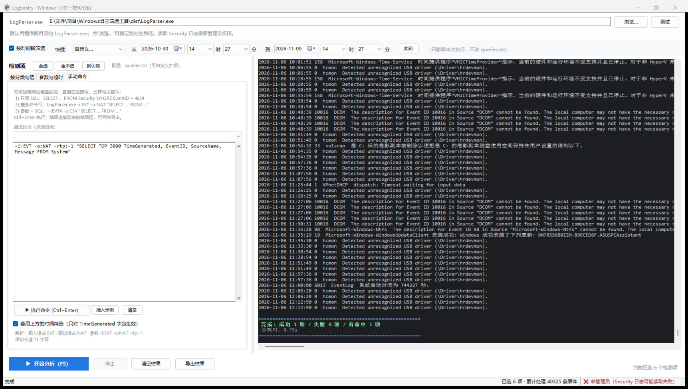

# LogSentry · Windows 日志一把梭分析

便携式 Windows 日志分析小工具：勾选多个检测项 → 一键顺序执行 → 在同一个窗口里比对
「攻击失败痕迹」和「攻击成功痕迹」。例如 4625 刷屏 + 紧随其后的 4624 成功登录 + 4720 新建账户 +
7045 安装服务，就是一条完整的爆破成功链。

底层调用微软 Log Parser 2.2（`LogParser.exe`）。**不需要 Python、Node 或任何第三方运行时**：
一个文件夹拷到任意 Win7 / Win10 / Win11 机器双击即可，自动 UAC 提权。

> 发布形式是 **zip 绿色包**，解压就是「资源管理器右键 → 全部解压缩」，
> 不需要装 7-Zip，解压这一步也不依赖任何 .NET。
> - **轻量包** `LogSentry_v1.0.zip`（1.0 MB）：主程序 + 引擎 + 配置 + 手册。Win10/11 自带
>   .NET 4.8，解压完直接能用。
> - **完整包** `LogSentry_v1.0_full.zip`（116.7 MB）：再加一份
>   `NDP48-x86-x64-AllOS-ENU.exe`（.NET Framework 4.8 离线安装包）。给 Win7 未打补丁 /
>   完全没有 4.5 的现场。
>
> 主程序要求 **.NET Framework 4.5+**（源码用了 async/await 与 ZipArchive，都是 4.5 才有的）。



## 功能

- **29 个内置检测项**，覆盖登录爆破、账户变更、服务安装与启停（7045 / 4697 / 7000 / 7009 / 7036 / 7040，PsExec 痕迹）、计划任务、日志清除、
  Defender 状态、Sysmon 进程创建等常见痕迹；可任意多选，按顺序执行。
- **时间筛选**：顶部筛选条支持最近 1h / 24h / 3d / 7d / 30d 与自定义区间，可精确到分秒；
  走 SQL 的 `TimeGenerated` 条件，不改 `queries.txt`。
- **手动命令**：左栏「手动命令」页可直接手写 SQL 或整条 LogParser 命令行，Ctrl+Enter 执行，
  历史命令自动留存。
- **自定义检测项**：左栏「自定义检测项」页可直接新增 / 复制 / 删除 / 停用检测项，
  填分组、名称、SQL 即可，「测试这条」当场试跑，命中条数和前 6 行写到右侧输出区。
  自定义项存到 `config\user-queries.txt`，与出厂 `queries.txt` 分家——升级换掉 `queries.txt`
  也不会冲掉自己的项；内置项用 `disabled: true` 停用，勾选页里灰显不执行。
- **导出**：文本 txt / CSV（每项一个文件 + 概述）/ Excel xlsx（每项一个工作表），
  CSV 与 xlsx 走 `-o:CSV` 重新查询生成，不在 NAT 文本上切列，中文不会串位。
- **配置驱动**：界面完全由 `queries.txt` 生成，新增检测项只改配置，不用改代码、不用重编译。
  运行时会额外合并 `config\user-queries.txt`：同 `id` 覆盖字段、写 `disabled: true` 就停用，
  新 `id` 直接追加。
  日志源不用手写，程序从 `query` 里 `FROM` 后面那一项自动识别并显示成 `[Security · 4624]`。

## 快速开始

1. 到 [Releases](https://github.com/Yumi10086/LogSentry/releases) 下载包
   （`LogSentry_v1.0.zip` 轻量包，或 `LogSentry_v1.0_full.zip` 完整包）→
   右键「全部解压缩」到 `D:\LogSentry` → 得到 `D:\LogSentry\LogSentry\` →
   进这个文件夹双击 `LogSentry.exe` → UAC 确认 → 界面打开。
   完整包里多一个 `NDP48-x86-x64-AllOS-ENU.exe`：目标机没有 .NET 4.5+、双击 `LogSentry.exe`
   弹「初始化错误 / 需要 .NET Framework 4.5 或更高」时，先双击它装好、重启一次。
   现场顺序就是：**解压 → 装 NDP48 → 重启 → 双击 `LogSentry.exe`**。
2. 左栏「按分类勾选」里挑检测项，例如同时勾上「登录失败」与「登录成功」。
3. 点 `▶ 开始分析（F5）`，结果区按项分隔显示，末尾给出成功 / 失败 / 命中汇总。
4. 需要留档就点「导出结果」，选 xlsx 或 csv。

只想临时用一次：把 `LogSentry.exe`、`LogParser.exe`、`queries.txt` 三个文件拷到同一目录，
双击 `LogSentry.exe` 即可（约 1.3 MB）。

## 三种包怎么选

| 包 | 大小 | 里面有什么 | 什么时候用 |
| --- | --- | --- | --- |
| `LogSentry_v1.0.zip`（轻量） | 1.0 MB | `LogSentry.exe`、`LogParser.exe`、`queries.txt`、`LogParser.chm`、`使用说明.txt` | 日常应急；Win10 / Win11 自带 .NET 4.8 |
| `LogSentry_v1.0_full.zip`（完整） | 116.7 MB | 上面全部 + `NDP48-x86-x64-AllOS-ENU.exe` | Win7 未打补丁 / 现场确认没有 .NET 4.5 |
| `dist\` 目录（源码构建） | — | 编译产物，不含安装包 | 开发调试，直接双击 `LogSentry.exe` |

两个 zip 都由 `pack-zip.ps1` 生成，解压后都是一个 `LogSentry\` 文件夹，不会把文件散到目标目录根。

## 交付物

| 文件 | 说明 |
| --- | --- |
| `LogSentry_v1.0.zip`、`LogSentry_v1.0_full.zip`（[Releases](https://github.com/Yumi10086/LogSentry/releases) 附件） | **绿色包**，`pack-zip.ps1` 产出，不入库（单个附件超 100 MB 会被 GitHub 拒收，所以只挂 Release） |
| `dist/LogSentry.exe` | 主程序本体，版本 1.0.0.0，需与 `LogParser.exe`、`queries.txt` 同目录 |
| `dist/LogParser.exe` | 微软 Log Parser 2.2，查询引擎 |
| `dist/LogParser.chm` | Log Parser 官方帮助文档 |
| `dist/queries.txt` | 检测项配置，改它就能增减检测项 |
| `dist/使用说明.txt` | 面向使用者的手册：界面、时间筛选、判读方法、导出、配置扩展示例、常见问题 |
| `dist/NDP48-x86-x64-AllOS-ENU.exe` | .NET Framework 4.8 离线安装包（微软官方，未修改，121,346,568 B），只在完整包里；缺运行库的机器自己双击装。不入库（`.gitignore`） |

## 仓库结构

```text
LogSentry/
├─ src/                     源码（C# 5 / .NET Framework 4.x，用系统自带 csc 直编）
│  ├─ app.manifest          requireAdministrator（双击即 UAC 提权）
│  ├─ Program.cs / EntryPoint.cs   启动入口、命令行分发（--selftest / --smoke）
│  ├─ MainForm.cs           全部界面与执行流程（左栏四页 + 结果区 + 导出）
│  ├─ Engine.cs             LogParser 封装：参数拼装、编码、超时、输出清理
│  ├─ Exporters.cs          CSV / XLSX 生成（手写 OOXML + ZipArchive）
│  ├─ Config.cs / BuiltinQueries.cs   queries.txt 解析（含与用户配置合并）+ 内置检测项
│  ├─ UserQueries.cs        config\user-queries.txt 的读写（自定义检测项落盘）
│  ├─ LogSource.cs          从 query 的 FROM 子句推断日志源（结果区标签用）
│  ├─ SelfTest.cs           --selftest 的全部断言（配置 / 合并 / 引擎 / 导出 / 中文）
│  └─ UiSmokeTest.cs        --smoke 的界面/导出/手动命令自动化冒烟
├─ build.ps1                csc 编译 → dist/LogSentry.exe + _selftest.exe + _smoke.exe
├─ pack-zip.ps1             7za 打绿色包 → .pkg/LogSentry_v1.0.zip（-WithDotNet 则带 NDP48）
├─ dist/                    交付产物（见上表）
│  └─ config/              （运行时生成）user-queries.txt 自定义检测项
├─ docs/
│  ├─ screenshots/          界面截图
│  ├─ evidence/             自检 / 冒烟 / 导出的实测输出
│  └─ DEVELOPMENT.md        开发与验证记录（LogParser 实测坑、迭代记录、复检命令）
└─ queries.txt              （dist/ 内副本）检测项配置
```

## 技术选型

- **C# WinForms / .NET Framework 4.x**：系统自带，Win10/11 是 4.8，Win7 装一次 4.8 离线包即可。
- 编译只用系统自带的 `C:\Windows\Microsoft.NET\Framework64\v4.0.30319\csc.exe`（C# 5 语法），
  不需要 Visual Studio、Roslyn 或 Reference Assemblies。
- **发布 = zip**：`7za a -tzip` 把暂存目录压成 zip，解压交给 Windows 自带资源管理器。
  既不用第三方解压器，也不依赖任何 .NET，跨 Win7～Win11 通用。
- `src/app.manifest` 写死 `requireAdministrator`：读 Security 日志必须有管理员权限。
- 执行用 `Process` + `async/await` + `RedirectStandardOutput`，`CreateNoWindow = true` 不弹黑框，
  输出按 OEM 代码页（简体中文为 CP936）解码，中文不乱码。

- **只读经典日志**：随包 `LogParser.exe` 是 32 位版，`FROM "Microsoft-Windows-Sysmon/Operational"`
  这种带斜杠的现代通道会被当成文件路径去找（实测 `Error searching for files in folder …`）；
  32 位进程读 `C:\Windows\System32\winevt\Logs` 还会被 WOW64 重定向到 `SysWOW64`。
  要查这类通道就 `wevtutil epl` 导出成 `.evtx`，再把 `FROM` 指到文件（已实测可查）。
  详见 [使用说明](dist/使用说明.txt) 第六节末尾的「附」和 [DEVELOPMENT](docs/DEVELOPMENT.md) §5.6。

> 为什么不做单文件 exe（7-Zip SFX）：`7z.sfx` / `7zS.sfx` / `7zCon.sfx` 都是纯 GUI 解压模块，
> 实测**不解析** `;!@Install@!` 段里的 `RunProgram / Directory / GUIMode`，双击只弹自己的
> 「Extract to:」对话框，从来没自动启动过；而且 116.7 MB 的单文件超过 GitHub 100 MB 上限，
> 只能挂 Release。zip 更简单：双击、右键、解压，没有中间层，也省掉一个 214 KB 的原生桩。

## 构建

```powershell
# 编译 dist\LogSentry.exe + dist\_selftest.exe + dist\_smoke.exe
powershell -NoProfile -ExecutionPolicy Bypass -File .\build.ps1

# 打轻量绿色包 → .pkg\LogSentry_v1.0.zip（约 1.0 MB）
powershell -NoProfile -ExecutionPolicy Bypass -File .\pack-zip.ps1

# 打完整绿色包 → .pkg\LogSentry_v1.0_full.zip（约 116.7 MB，带 .NET 4.8 离线安装包）
powershell -NoProfile -ExecutionPolicy Bypass -File .\pack-zip.ps1 -OutputName LogSentry_v1.0_full.zip -WithDotNet

# 换压缩级别（默认 5，取值 0-9）
powershell -NoProfile -ExecutionPolicy Bypass -File .\pack-zip.ps1 -CompressionLevel 9
```

`build.ps1` 自动寻找 `csc.exe`（优先 Framework64，回退 32 位），优先使用
`Reference Assemblies\...\v4.8`，否则回退 Framework 目录里的 GAC 引用。它只编译，不打包。

`pack-zip.ps1` 用 `.tools\extra\7za.exe`（仓库自带，不用装 7-Zip）把
`.pkg\zipstage\LogSentry\` 打成 zip（`-tzip -mx=5`），打完跑一次 `7za t` 校验、打印 SHA256，
并清掉暂存目录。必需文件缺任何一个直接报错退出；可选文件（`*.txt` 手册、`LogParser.chm`）有就带。

> 两个 ps1 都必须存成 **UTF-8 with BOM**。没有 BOM 时 Windows PowerShell 5.1 按 GBK 读脚本，
> 中文注释里的多字节序列会吃掉后面的引号，报 `Unexpected token`。用工具改完文件后记得补 BOM。

## 自检

```powershell
cd dist
.\_selftest.exe                                            # 命令行全链路自检
.\_smoke.exe --smoke . service_install,logon_success       # 无人值守跑一遍真实界面
```

`_selftest.exe` 全绿时最后一行是 `=== 全部通过 ===`；`_smoke.exe` 会真实开窗、勾选、执行、
截图并写出 `ui-results.txt`，最后一行 `RESULT = OK`。完整断言清单、参数说明与复检命令见
[docs/DEVELOPMENT.md](docs/DEVELOPMENT.md)。

非管理员会话下 Security 类检测项会报权限不足，这是预期行为，`_smoke.exe` 会汇报成
`RESULT = OK(部分项按预期失败)`。

## 架构

`MainForm` 不认任何具体事件号，界面完全按 `queries.txt` 生成。新增检测项 = 往 `queries.txt`
加一段 `[id] / label / query`，重启即见（`log:` 是旧字段，已不再读取，留着也不报错）：

```ini
[logon_fail]
label: 登录失败 (4625)
query: SELECT TimeGenerated, EXTRACT_TOKEN(Strings, 5, '|') AS TargetUser, ... FROM Security WHERE EventID = 4625
```

结果区标题里的日志源（`[Security · 4624]`）由 `src/LogSource.cs` 从 SQL 的 `FROM` 子句实时推断，
认不出来（没有 FROM、FROM 后面是文件路径、手动命令）就只显示事件号。

执行全程 `await`，每项之间刷新状态栏与计数，执行期禁用「开始分析」，「停止」随时可用。
结果渲染按样式攒进缓冲区、节拍统一写入，长输出列表也不拖慢界面。

## 文档

- `dist/使用说明.txt` —— 面向使用者
- [docs/DEVELOPMENT.md](docs/DEVELOPMENT.md) —— 开发与验证记录（LogParser 实测坑、迭代记录、复检命令、源码维护注意）
- `dist/LogParser.chm` —— Log Parser 官方帮助

## 许可与声明

本仓库仅包含自研代码与微软官方免费分发工具 Log Parser 2.2 的原始二进制，未做修改。
`LogParser.exe` / `LogParser.chm` 版权归 Microsoft Corporation 所有，按其随附许可使用。
其余代码可用于任何用途，不提供任何担保。
